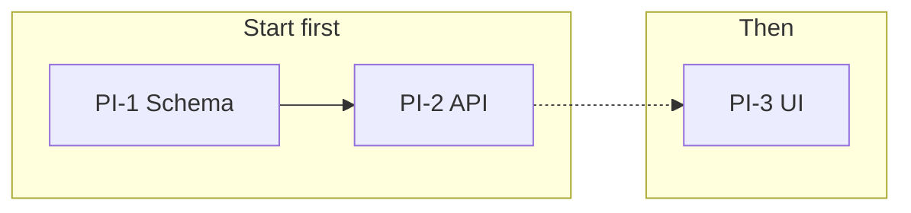

# Backlog dependency maps

Use this only when a report covers several tickets with dependencies or a suggested order. A single completed ticket gets its ID and status in the `meta` line, not a map.

Draw the map as one `diagram` change with only `after`, as a Mermaid `flowchart LR`:

- One `subgraph` per lane: a workstream one person or pair can own. Order lanes top to bottom by when they should start, and name them by outcome, not `Lane 1`.
- Within a lane, place tickets left to right in suggested order. Tickets that should start together sit at the same depth.
- `-->` only for a hard dependency stated in Backlog or established by evidence. `-.->` for a suggested, non-blocking order. Leave unrelated tickets unconnected.
- Node text is the exact ticket ID and a short title, e.g. `T7["PI-12 Schema"]`. Mark tickets this work added with `:::added` and tickets it removed with `:::removed`.

Use the change's `note` for what the map cannot show, such as which lane can be deferred. Do not restate the order in prose.
